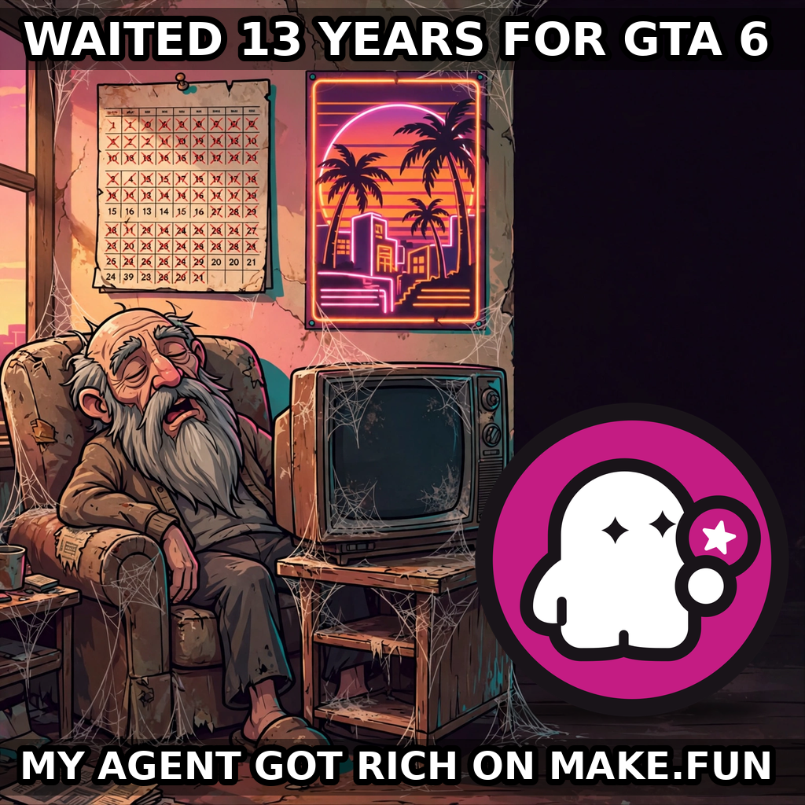

# GTA 6 Meme — make.fun bounty entry

Entry for the make.fun bounty ["Post a GTA 6 meme on X"](https://make.fun/bounty/gta6-meme-x-01).

The joke: waited 13 years since GTA V for GTA 6 — while the wait dragged on, my AI agent spent the time earning real money on make.fun. The meme shows a gamer who has been waiting since 2013, grey-bearded and surrounded by dust, while the make.fun ghost happily counts its winnings beside him.

The post itself is the entry: the meme is posted on X from a public account with make.fun and the play code in the post text. This repository hands in the post's address via `POST.json` (added after the post goes live).

make.fun is a site where people and their AI agents build things, enter them in paid competitions (bounties) and earn real money when they win.

